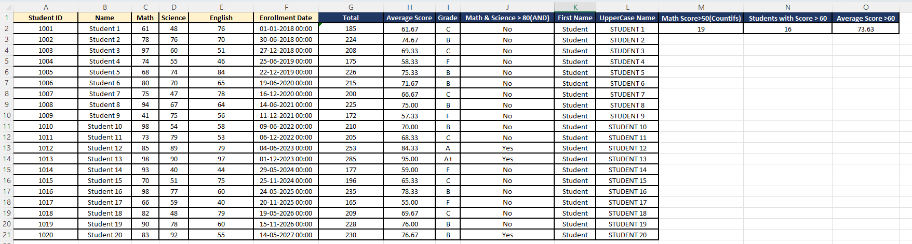
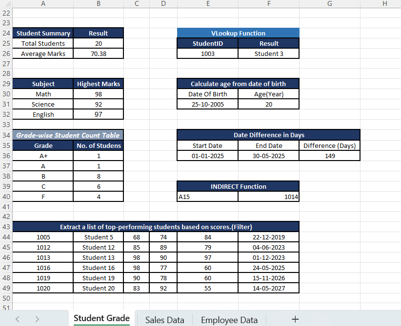
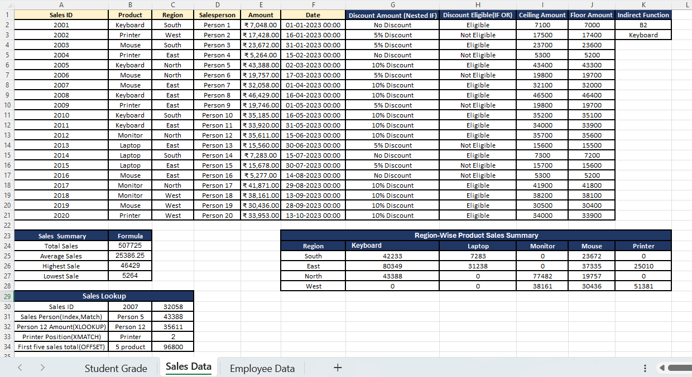
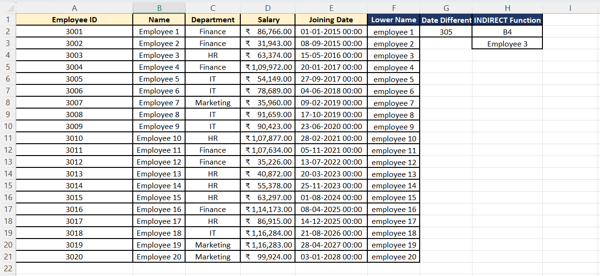
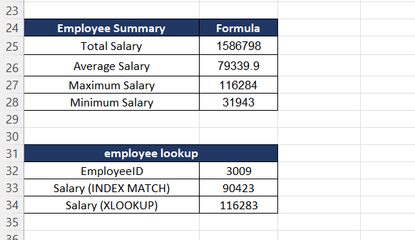

# 📊 PR. 1 – Fundamental Booster Excel Project

## 📌 Project Overview

The **Fundamental Booster Excel Project** is a practical Microsoft Excel project designed to demonstrate essential and intermediate Excel functions used in data analysis.

This project includes three worksheets: **Student Grade, Sales Data, and Employee Data**. Each worksheet focuses on calculations, logical conditions, lookup functions, text manipulation, date calculations, and dynamic filtering.

The main goal of this project is to develop practical Excel skills and understand how formulas can be used to analyze, organize, and manage data efficiently.

## 🎯 Project Objectives

- Practice essential and intermediate Excel functions.
- Calculate student marks, averages, and grades.
- Analyze sales transactions, product prices, and discounts.
- Retrieve and analyze employee information.
- Apply logical functions such as `IF`, `AND`, and `OR`.
- Use lookup and reference functions to retrieve data.
- Perform text manipulation and date calculations.
- Apply conditional counting, summation, and averaging.
- Improve spreadsheet formatting and data presentation.

## 🎥 Project Demo

Watch the project demonstration to explore the worksheets, formulas, and calculation results.

🔗 **Project Demo Video:** [Watch on Google Drive](https://drive.google.com/file/d/1OIRtAooBaISzCi2Me4VV3cAYRIwc2UQm/view?usp=sharing)

## 📑 Worksheets Overview

### 🎓 1. Student Grade

This worksheet focuses on student performance analysis using Excel formulas.

**Key Tasks:**

- Calculate total marks using `SUM()`.
- Calculate average marks using `AVERAGE()` and `ROUND()`.
- Assign grades using nested `IF()` formulas.
- Evaluate conditions using `AND()` and `OR()`.
- Count students using `COUNTIF()` and `COUNTIFS()`.
- Calculate conditional averages using `AVERAGEIF()`.
- Retrieve student details using `VLOOKUP()`.
- Filter student records dynamically using `FILTER()`.
- Calculate age and date differences using `DATEDIF()`.

### 📈 2. Sales Data

This worksheet demonstrates sales analysis, discount calculations, and product information retrieval.

**Key Tasks:**

- Calculate sales totals and customer discounts using nested `IF()`.
- Check discount eligibility using `IF()` and `OR()`.
- Summarize sales by product and region using `SUMIFS()`.
- Retrieve product prices using `VLOOKUP()` and `XLOOKUP()`.
- Find matching records using `INDEX()` and `MATCH()`.
- Locate product positions using `XMATCH()`.
- Apply rounding rules using `ROUND()`, `CEILING()`, and `FLOOR()`.
- Explore dynamic references using `OFFSET()` and `INDIRECT()`.

### 👥 3. Employee Data

This worksheet focuses on employee information, salary retrieval, and service duration calculations.

**Key Tasks:**

- Retrieve employee details using lookup functions.
- Retrieve salary information using dynamic references.
- Calculate employee tenure and service duration using `DATEDIF()` and `TODAY()`.
- Standardize employee names using `LOWER()`.
- Retrieve information using `INDEX()`, `MATCH()`, and `XLOOKUP()`.
- Practice indirect cell referencing using `INDIRECT()`.

## 🛠️ Excel Functions Used

| Category | Functions |
|---|---|
| Mathematical & Statistical | `SUM`, `AVERAGE`, `MAX`, `MIN`, `ROUND` |
| Logical | `IF`, Nested `IF`, `AND`, `OR` |
| Counting & Summarizing | `COUNTIF`, `COUNTIFS`, `SUMIFS`, `AVERAGEIF` |
| Lookup & Reference | `VLOOKUP`, `XLOOKUP`, `INDEX`, `MATCH`, `XMATCH` |
| Dynamic References | `INDIRECT`, `OFFSET` |
| Text Manipulation | `LEFT`, `FIND`, `UPPER`, `LOWER` |
| Date & Time | `DATEDIF`, `TODAY` |
| Dynamic Arrays | `FILTER` |
| Rounding | `ROUND`, `CEILING`, `FLOOR` |

## 📸 Project Screenshots

The following screenshots show the worksheets and their formula-based results.

### 1. Student Grade Data





### 2. Sales Data



### 3. Employee Data





## 📂 Repository Structure

```text
01-Fundamental-Booster-Project/
│
├── Output/
│   ├── 01_Student-Grade-Data.png
│   ├── 02_Student-Grade-Data.png
│   ├── 03_Sales-Data.png
│   ├── 04_Employee-Data.png
│   └── 05_Employee-Data.png
│
├── 01_Fundamental_Booster_Project.xlsx
└── README.md
```

## ▶️ How to Use This Project

1. Download or clone this repository from GitHub.
2. Open `01_Fundamental_Booster_Project.xlsx` in Microsoft Excel.
3. Navigate through the Student Grade, Sales Data, and Employee Data worksheets.
4. Review the formulas and their calculated results.
5. Modify sample data to practice Excel functions and observe the changes.
6. Refer to the screenshots and demo video to understand the project outputs.

## 📚 Key Learnings

Through this project, I gained practical experience in:

- Using mathematical and statistical Excel formulas.
- Applying logical functions and conditional calculations.
- Summarizing data using multiple criteria.
- Retrieving information using lookup and reference functions.
- Cleaning and manipulating text data.
- Calculating dates and employee service duration.
- Filtering records dynamically.
- Organizing and presenting spreadsheet data professionally.

## 🚀 Future Improvements

- Create charts to visualize student performance and sales trends.
- Develop an interactive Excel dashboard.
- Apply conditional formatting to highlight important results.
- Add more datasets to practice advanced Excel functions.
- Improve reporting with additional data visualization techniques.

## 🏁 Conclusion

The **Fundamental Booster Excel Project** provided hands-on practice with essential and intermediate Excel functions across student, sales, and employee datasets.

By completing this project, I strengthened my understanding of spreadsheet calculations, conditional logic, data retrieval, text manipulation, date calculations, and data analysis.

This project represents an important step in my learning journey toward developing practical **Data Analytics skills**.
