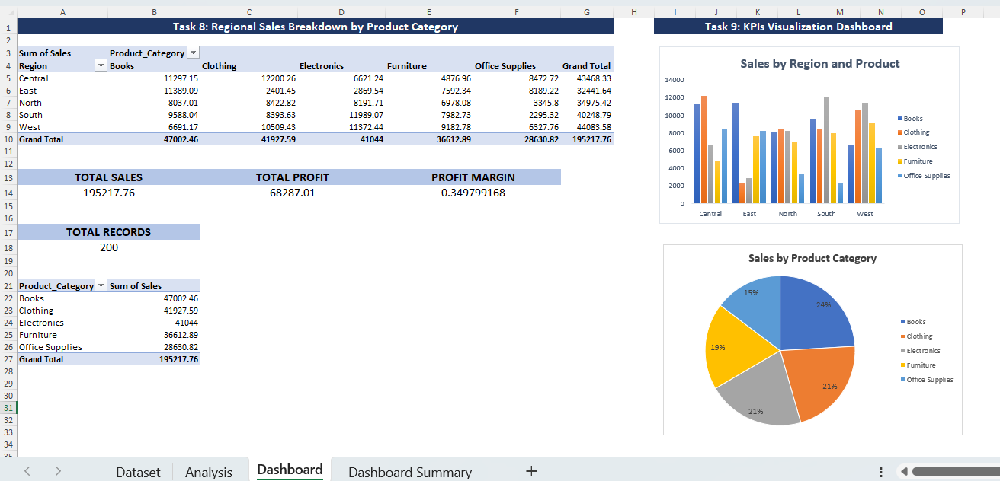
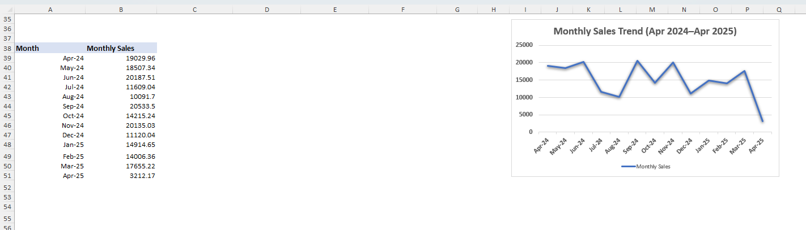
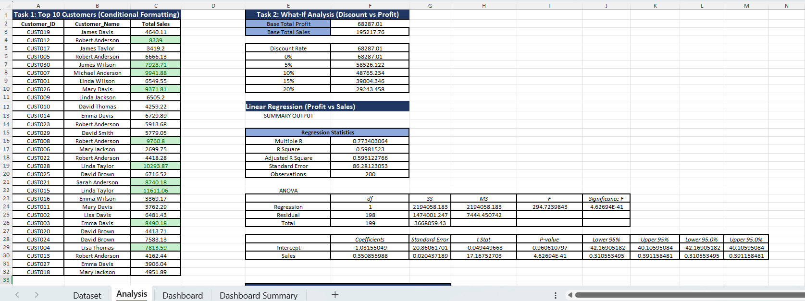
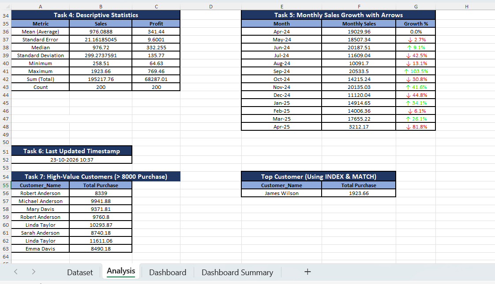
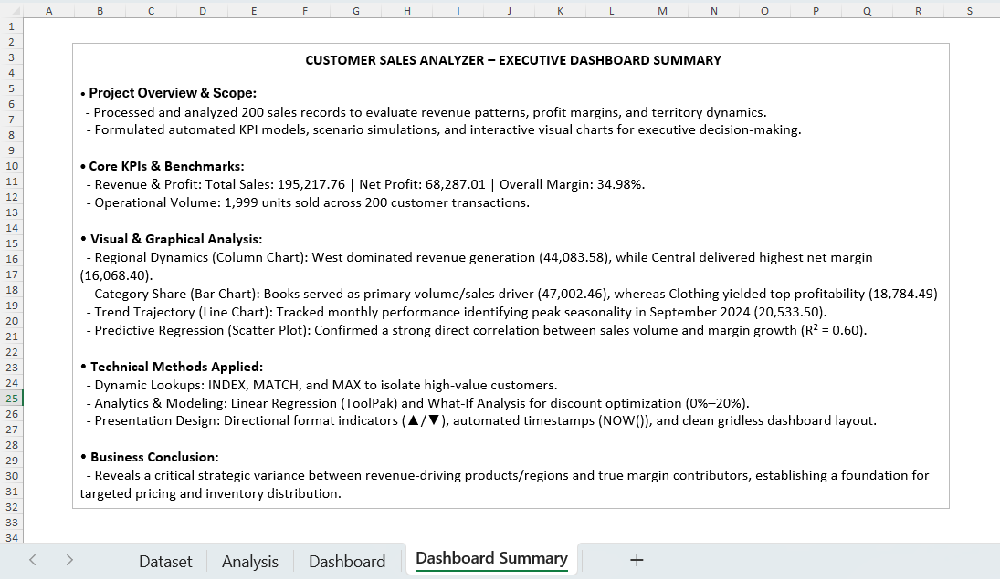

## 🎥 Project Demo

Watch the project demonstration to explore the worksheets, formulas, and calculation results.

🔗 **Project Demo Video:** [Watch on Google Drive](https://drive.google.com/file/d/1OIRtAooBaISzCi2Me4VV3cAYRIwc2UQm/view?usp=sharing)

## 📊 Customer Sales Analyzer

The **Customer Sales Analyzer** is a Microsoft Excel project focused on analyzing sales data and customer purchasing patterns. I used Excel formulas, lookup functions, and statistical analysis to calculate total sales and profit, analyze customer purchases, compare regional performance, and identify high-value customers. The project also includes discount What-If Analysis, regression analysis, descriptive statistics, and monthly sales trend analysis. The results are organized into summary tables and a dashboard to make the data easier to understand.

---

## 🎯 Project Objective

The objective of this project is to transform raw sales records into meaningful business insights and demonstrate practical Excel skills for data analysis.

**Key objectives:**
- Analyze total sales, profit, and profit margin.
- Identify high-value customers based on their purchases.
- Compare sales performance across regions and product categories.
- Explore discount scenarios and the relationship between sales and profit.
- Analyze monthly sales trends and present key metrics through a dashboard.

## 📂 Workbook Structure

| Worksheet | Description |
|---|---|
| `Dataset` | Contains the original sales records and related customer, product, region, and transaction details. |
| `Analysis` | Includes customer sales analysis, discount What-If Analysis, regression, descriptive statistics, monthly sales trends, and high-value customer analysis. |
| `Dashboard` | Presents regional sales breakdowns, product category summaries, KPIs, and monthly sales summaries. |
| `Dashboard Summary` | Provides additional summary information for project reporting and future improvements. |

## 🛠️ Skills & Excel Features

**Formulas and Functions**
- Statistical functions: `SUM`, `AVERAGE`, `MEDIAN`, `MIN`, `MAX`, `COUNT`
- Logical functions: `IF`, `IFERROR`
- Conditional aggregation: `SUMIF`, `SUMIFS`
- Lookup functions: `VLOOKUP`, `INDEX`, `MATCH`
- Date functions: `EDATE`, `NOW`, and monthly date calculations

**Data Analysis Techniques**
- Customer-level sales calculations
- Discount What-If Analysis
- Regression analysis and descriptive statistics
- Monthly sales trend and growth analysis
- Regional and product category comparisons
- KPI summaries and dashboard reporting

## 🔍 Analysis Highlights

1. **Customer Sales Analysis:** Retrieves customer names using customer IDs and calculates total purchases.
2. **Discount What-If Analysis:** Estimates profit under different discount assumptions.
3. **Regression Analysis:** Examines the relationship between sales and profit.
4. **Descriptive Statistics:** Calculates statistical measures for sales and profit.
5. **Monthly Sales Trend:** Summarizes monthly sales and calculates growth.
6. **High-Value Customer Analysis:** Identifies customers whose total purchases exceed 8,000.
7. **Regional Sales Analysis:** Compares sales across regions and product categories.
8. **KPI Summary:** Presents total sales, total profit, profit margin, and record count.

## 📈 Key Results

The current workbook contains **200 sales records**.

| Metric | Result |
|---|---:|
| Total Sales | 195,217.76 |
| Total Profit | 68,287.01 |
| Total Records | 200 |
| Product Categories | 5 |
| Regions | 5 |

*Note: These results are based on the current workbook data. The source dataset does not specify a currency unit.*

---

## 🖼️ Output Screenshots

### 1. Executive Dashboard & Visualizations


### 2. Monthly Revenue Trend & Seasonality


### 3. Statistical Regression & What-If Sensitivity Analysis


### 4. Customer Lookup & High-Value Segmentation


### 5. Project Executive Summary


## 🚀 How to Use

1. Download or clone this repository.
2. Open the Excel workbook in Microsoft Excel.
3. Review the `Dataset`, `Analysis`, and `Dashboard` worksheets.
4. Select calculated cells to inspect their formulas in the formula bar.
5. Check that formula-driven outputs have recalculated correctly.

## 📁 Repository Structure

```text
PR2-Customer-Sales-Analyzer/
│
├── README.md
├── PR2-Customer_Sales_Analyzer.xlsx
└── Output/
    ├── dashboard-overview.png
    ├── dashboard-overview1.png
    ├── statistical-modeling.png
    ├── customer-lookup-trends.png
    └── project-summary-card.png
```
## 💡 Key Business Insights

- Analyzed overall sales and profit performance using summary metrics.
- Compared sales performance across regions and product categories.
- Examined customer purchasing patterns to identify high-value customers.
- Explored the potential impact of different discount scenarios on profit.
- Reviewed monthly sales trends to understand changes in performance.


## 🔮 Future Improvements

- Add interactive slicers and filters for regions, categories, and dates.
- Create additional charts for monthly sales and profitability.
- Improve formatting with consistent colors, number formats, and conditional formatting.
- Validate formulas and refresh dashboard outputs when the source data changes.
- Add business recommendations based on the analysis results.

---
