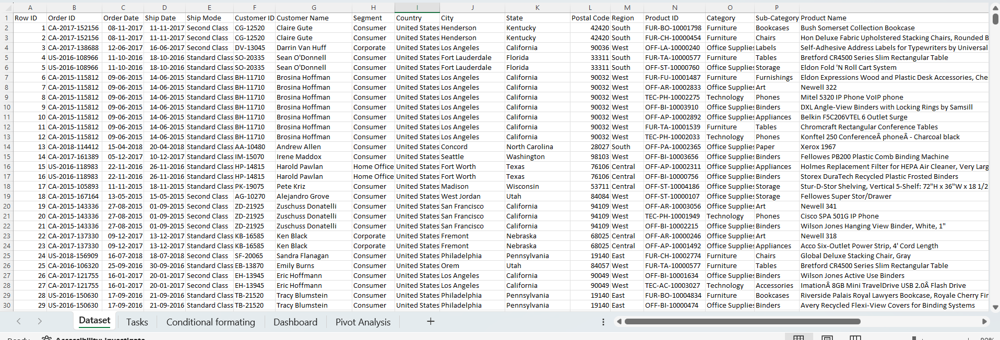
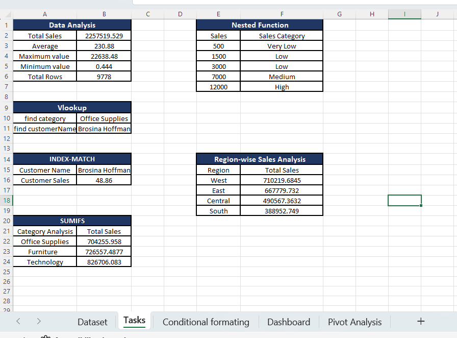
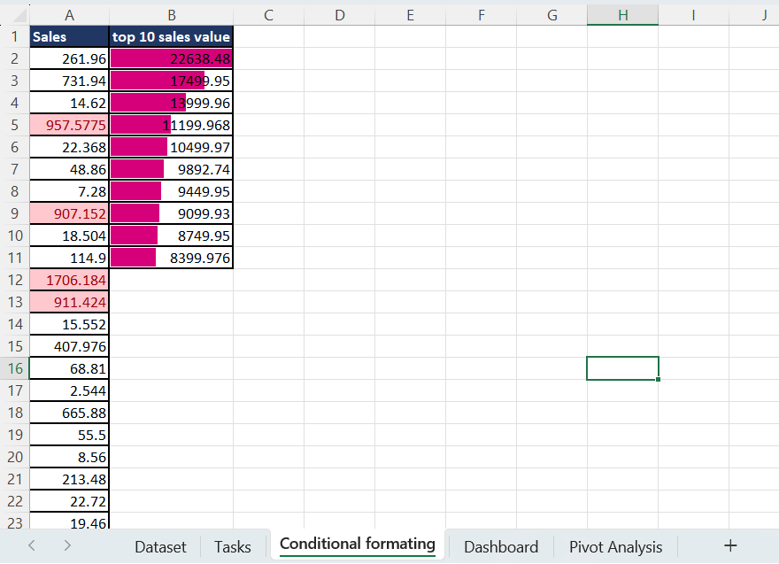
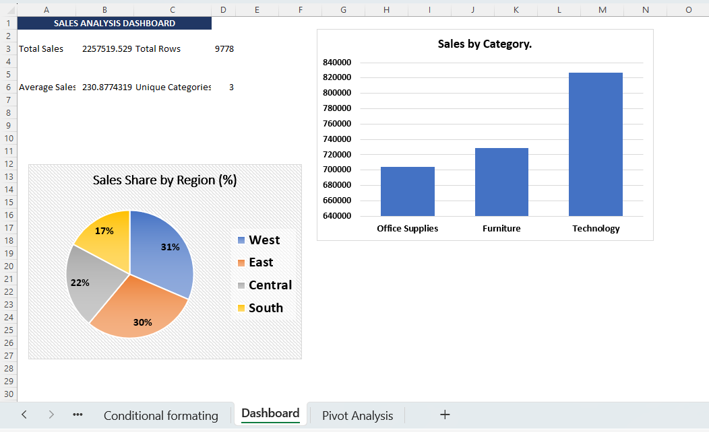
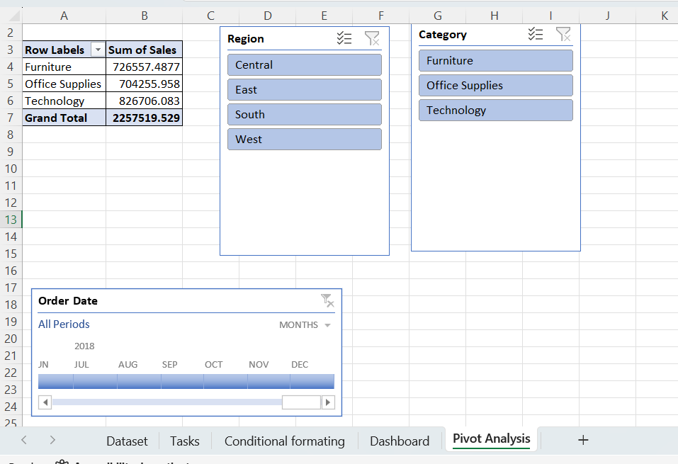

# 📊 Sales Analysis Dashboard — Excel Final Project

<!-- ======================= HEADER WAVE ======================= -->
<div align="center">  <br/>     </div>


---

## 🎥 Project Demo

Watch the project demonstration to explore the worksheets, formulas, and calculation results.

<div align="center">

🔗 **Project Demo Video:** [▶️ Watch on Google Drive](https://drive.google.com/file/d/15-Y81eJOt8NlLtjtyL0qiNK6vj9jLJBL/view?usp=sharing)

</div>

---

## 🎯 Project Overview

This project analyses retail sales transactions to answer questions such as:

- What are the **total, average, highest and lowest** sales?
- Which **product category** and **region** generate the most revenue?
- Who are the **top customers**, and which orders are the largest?
- How can all of this be explored **interactively** by a non-technical user?

The workbook combines core Excel skills — data cleaning, lookup and conditional formulas, pivot tables, charts and slicers — into a single, easy-to-navigate dashboard.

---

## 🗂️ Dataset

| Property | Details |
|---|---|
| **Sheet** | `Dataset` |
| **Records** | 9,800 transactions |
| **Columns** | 18 |
| **Period** | January 2015 – December 2018 |
| **Geography** | United States (4 regions) |
| **Categories** | Furniture, Office Supplies, Technology |
| **Customers** | 793 unique customers |

**Columns:** `Row ID` · `Order ID` · `Order Date` · `Ship Date` · `Ship Mode` · `Customer ID` · `Customer Name` · `Segment` · `Country` · `City` · `State` · `Postal Code` · `Region` · `Product ID` · `Category` · `Sub-Category` · `Product Name` · `Sales`

---

## 🧭 Workbook Structure

| # | Sheet | Purpose |
|---|---|---|
| 1 | 📄 **Dataset** | Raw transaction data (source of truth) |
| 2 | 🧮 **Tasks** | All formula work: summary stats, VLOOKUP, INDEX-MATCH, SUMIF, nested IF |
| 3 | 🎨 **Conditional formating** | Highlighting of high sales and a Top-10 list with data bars |
| 4 | 📈 **Dashboard** | KPI cards and charts for a quick business overview |
| 5 | 🔄 **Pivot Analysis** | Pivot table with Region and Category slicers and an Order Date timeline |

---
## 🧮 Formulas Used

### 📌 Summary Statistics
| Function | Use |
|---|---|
| `SUM` | Calculates the **total sales** of all transactions |
| `AVERAGE` | Finds the **average sale value** per order line |
| `ROUND` | Rounds the average to **2 decimal places** for clean display |
| `MAX` | Finds the **highest single sale** in the dataset |
| `MIN` | Finds the **lowest single sale** in the dataset |
| `COUNT` / `COUNTA` | Counts the **total number of records** (rows) |

### 🔍 Lookup Functions
| Function | Use |
|---|---|
| `VLOOKUP` | Searches a value in the first column and returns related data, e.g. **finds Category from Product ID** and **Customer Name from Customer ID** |
| `INDEX` + `MATCH` | A flexible lookup that **finds a customer's sales** by customer name; works without column-order limits |

### ➕ Conditional Summing
| Function | Use |
|---|---|
| `SUMIF` | Adds sales only when a condition is met, used for **Category-wise** (Furniture, Office Supplies, Technology) and **Region-wise** (West, East, Central, South) sales analysis |

### 🧠 Logical Function
| Function | Use |
|---|---|
| Nested `IF` | Classifies each sales amount into **High, Medium, Low or Very Low** using multiple conditions |

### 🏆 Ranking Functions
| Function | Use |
|---|---|
| `LARGE` | Returns the **nth highest sale value**, used to build the **Top 10 sales** list |
| `ROWS` | Gives the rank number (1, 2, 3…) automatically so `LARGE` can be copied down |
---

## 🔄 Pivot Table, Slicers & Timeline

- **Pivot Table:** Sum of Sales grouped by Category.
- 🎛️ **Slicers:** `Region` and `Category` for one-click filtering.
- ⏱️ **Timeline:** `Order Date` for filtering by year, quarter or month.

| Category | Total Sales |
|---|---:|
| Furniture | 726,557.49 |
| Office Supplies | 704,255.96 |
| Technology | 826,706.08 |
| **Grand Total** | **2,257,519.53** |

---

## 🎨 Conditional Formatting

- 🟥 **Highlight rule:** Sales values **greater than 900** are highlighted automatically.
- 📊 **Data bars:** The Top-10 sales list is visualised with data bars.
- 🏆 **Top 10 formula:**
  ```excel
  =LARGE($A$2:$A$9779, ROWS(B$2:B2))
  ```

---

## 📈 Dashboard

The **Dashboard** sheet gives a one-glance business summary:

| KPI | Description |
|---|---|
| 💰 Total Sales | Sum of all sales |
| 🧾 Total Rows | Number of order lines |
| 📉 Average Sales | Mean sale value |
| 🗃️ Unique Categories | Count of product categories |

**Charts**
- 📊 **Sales by Category** (bar chart)
- 🥧 **Sales by Region** (pie chart)

---

## 💡 Key Insights

- 🥇 **Technology** is the top-performing category by revenue, ahead of Furniture and Office Supplies.
- 🪑 **Furniture** and 🖇️ **Office Supplies** are close to each other, so both are significant contributors.
- 🌎 Revenue is split across four regions (West, East, Central, South), so regional comparison is easy through the pie chart and slicers.
- 🔝 The Top-10 list quickly exposes the largest individual orders.

---


### 1. Dataset — Raw Transaction Data


### 2. Tasks — Formulas (VLOOKUP, INDEX-MATCH, SUMIF, Nested IF)


### 3. Conditional Formatting & Top 10 Sales


### 4. Sales Analysis Dashboard


### 5. Pivot Analysis — Slicers & Timeline


---

## 🚀 How to Use

1. 📥 Open `Final-exam1.xlsx` in **Microsoft Excel** (2013 or later recommended — slicers and timelines need it).
2. 👀 Start at the **Dashboard** sheet for the overview.
3. 🔄 Go to **Pivot Analysis** and click the Region / Category slicers or drag the Order Date timeline to filter.
4. 🧮 Open **Tasks** to see each formula. Change the customer name in `B15` or the sales values in `A36:A40` to test them.
5. ♻️ After editing the data, press **Data → Refresh All** to update the pivot table and charts.

---

## ⚠️ Known Notes & Improvements

- 📏 The formulas reference `Dataset!R2:R9779`, but the dataset runs to row **9801**. The last 22 rows are therefore excluded from totals (formula total ≈ 2,257,519.53 vs. full-data total ≈ 2,261,536.78). Extending ranges to row 9801, or converting the data to an **Excel Table** so ranges grow automatically, fixes this.
- 🏷️ The sheet name `Conditional formating` contains a typo — consider renaming to `Conditional Formatting`.
- 🔗 `Tasks!A23` has a stray tab character and its SUMIF points to `Dataset!O7`; using `A23` as the criteria (like the other rows) would be cleaner.
- 🕳️ `Postal Code` has 11 blank values (not used in any calculation).
- 🔠 Consider **named ranges** (e.g. `Sales`, `Region`) for more readable formulas.

---

## 🛠️ Skills Demonstrated

| Area | Skills |
|---|---|
| 📥 Data | Import, cleaning, formatting data types |
| 🧮 Formulas | SUM, AVERAGE, MAX, MIN, COUNT, VLOOKUP, INDEX-MATCH, SUMIF, LARGE, nested IF |
| 📊 Analysis | Pivot tables, summarisation |
| 🎨 Visualisation | Charts, conditional formatting, data bars |
| 🎛️ Interactivity | Slicers, timeline, KPI dashboard |
| 📚 Documentation | Sheet organisation, naming, README |

---

