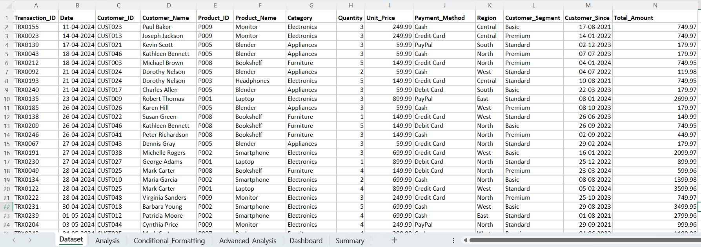
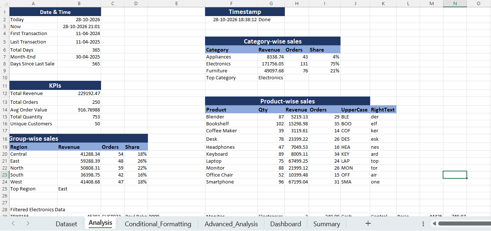
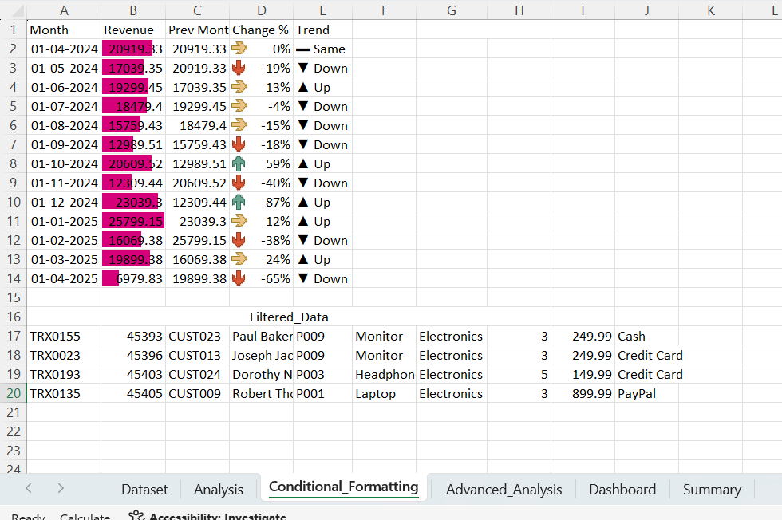
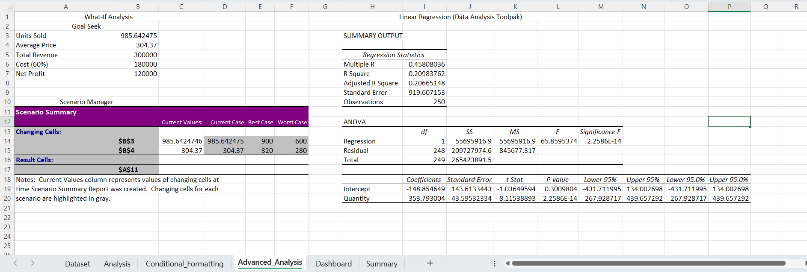

# 📊 Retail Sales Data Intelligence Dashboard & Advanced Analytics


## 🎥 Project Demo

Watch the project demonstration to explore the worksheets, formulas, and calculation results.

<div align="center">

🔗 **Project Demo Video:** [▶️ Watch on Google Drive](https://drive.google.com/file/d/15-Y81eJOt8NlLtjtyL0qiNK6vj9jLJBL/view?usp=sharing)

</div>

---
## 📌 Project Overview
Yeh project ek comprehensive **Retail Sales Data Intelligence & Business Analytics Dashboard** hai jise Microsoft Excel ke advanced analytical functions, dynamic modeling, aur statistical tools ka upyog karke build kiya gaya hai.

Workbook me **250 retail transactions** ka multi-dimensional analysis shamil hai, jisme customer purchasing patterns, category-wise revenue distribution, regional sales growth, Month-over-Month (MoM) performance tracking, What-If scenario simulations aur linear regression modeling ko cover kiya gaya hai.

---

## 📈 Key Performance Indicators (KPIs)

| Metric | Value | Business Insight |
| :--- | :--- | :--- |
| **Total Revenue** | **$229,192.47** | Cumulative sales revenue across all categories |
| **Total Orders** | **250** | Overall transaction volume |
| **Average Order Value (AOV)** | **$916.77** | Average revenue generated per customer transaction |
| **Total Units Sold** | **753 units** | High retail inventory movement |
| **Unique Customers** | **50** | Diverse customer base across multiple segments |
| **Top Category** | **Electronics** | Dominates **74.94%** of total business revenue |
| **Top Performing Region** | **East** | Contributes **$59,288.39** (~25.87% revenue share) |

---

## 🗂️ Workbook Architecture & Module Breakdown

Workbook ko structured aur modular workflow me divide kiya gaya hai:

### 1. `Dataset` (Raw Data Layer)
* **Description:** 250 verified retail sales records ka master transactional repository.
* **Key Fields:** `Transaction_ID`, `Date`, `Customer_ID`, `Customer_Name`, `Product_ID`, `Product_Name`, `Category`, `Quantity`, `Unit_Price`, `Payment_Method`, `Region`, `Customer_Segment`, `Customer_Since`, `Total_Amount`.

### 2. `Analysis` (Core KPI & Performance Engine)
* **Date & Time Tracking:** Dynamic time calculations using `=TODAY()`, `=NOW()`, `=MIN()`, aur `=MAX()` for transaction timeline tracking.
* **Category-wise Breakdown:**
  * **Electronics:** $171,756.05 (131 orders | 74.94% share)
  * **Furniture:** $49,097.68 (76 orders | 21.42% share)
  * **Appliances:** $8,338.74 (43 orders | 3.64% share)
* **Regional Distribution:** Performance tracking across Central, East, North, South aur West regions.
* **Product-Level Breakdown:** Unit sales aur revenue metrics for 10 core products (Laptops, Desks, Bookshelves, Monitors, etc.).

### 3. `Conditional_Formatting` (MoM Growth & Trend Analytics)
* **Dynamic Time Series:** Dynamic monthly date generation using `=DATE()` aur `=EDATE()`.
* **Revenue Calculation:** Strict monthly boundary revenue aggregation using `=SUMIFS()` and `=EOMONTH()`.
* **MoM Variance & Trend Indicators:**
  * Automated percentage growth formulas: `=(Current - Previous) / Previous`.
  * Visual status tracking using dynamic logic:
    ```excel
    =IF(Change > 0, "▲ Up", IF(Change < 0, "▼ Down", "▬ Same"))
    ```
  * Soft color heatmaps aur direction indicators for executive reporting.

### 4. `Advanced_Analysis` (Predictive Modeling & What-If Simulations)
* **Goal Seek Simulation:** Target revenue ($300,000) aur net profit ($120,000 at 40% margin) achieve karne ke liye required sales volume (985.64 units at average price $304.37) optimize kiya gaya.
* **Scenario Manager:** Sensitivity planning model built across three scenarios:
  * **Current Case:** 986 units @ $304.37
  * **Best Case:** 900 units @ $320.00
  * **Worst Case:** 600 units @ $280.00
* **Linear Regression (Data Analysis Toolpak):**
  * Evaluated relationship between `Quantity` and `Total_Amount`.
  * **Observations:** 250
  * **Multiple R:** 0.458 | **R Square ($R^2$):** 0.2098
  * **F-Significance / P-Value:** $2.26 \times 10^{-14}$ (statistically highly significant correlation).

### 5. `Dashboard` & `Summary` (Executive Reporting Layer)
* High-level executive visual view, KPI callouts, category share breakdowns, aur actionable business recommendations.

---

## 🛠️ Advanced Excel Toolkit & Functions Used

* **Lookup & Reference:** Dynamic ranges, cell references across sheets.
* **Logical & Aggregation Functions:** `SUMIFS`, `COUNTIFS`, `AVERAGEIFS`, `IF`, `MIN`, `MAX`.
* **Date & Time Intelligence:** `TODAY()`, `NOW()`, `DATE()`, `EDATE()`, `EOMONTH()`.
* **Statistical & Predictive Analysis:** Excel Analysis Toolpak (Linear Regression, ANOVA summary output, coefficient significance testing).
* **Decision Support Modeling:** Goal Seek, Scenario Manager.
* **Visualization:** Conditional Formatting rules, Data Bars, Custom Trend Icons, Pivot Tables.

---

## 🗂️ Workbook Architecture & Module Previews

### 1. Raw Dataset Layer (`Dataset.png`)
250 verified retail sales records ka master transactional repository jisme transaction details, customer profiles, product categories aur payment methods properly clean aur structured hain.



---

### 2. Core KPI & Data Analysis Engine (`Data-analysis.png`)
Category-wise revenue distribution, product-level unit sales aggregation, regional metrics aur dynamic date calculations (`TODAY()`, `NOW()`, `MIN()`, `MAX()`).



---

### 3. Conditional Formatting & MoM Trends (`Conditional-formating.png`)
Dynamic time-series analysis jisme `=DATE()`, `=EDATE()`, aur `=SUMIFS()` use karke monthly sales boundary track ki gayi hai. MoM growth status automated icons (`▲ Up`, `▼ Down`, `▬ Same`) aur color bars se visualised hai.



---

### 4. Advanced What-If & Linear Regression (`Linear-regression.png`)
Excel Data Analysis Toolpak dwara Linear Regression output (Multiple R: 0.458, $R^2$: 0.2098, F-Significance: $2.26 \times 10^{-14}$) aur revenue/profit sensitivity ke liye Goal Seek aur Scenario Manager ka implementation.



---

## 💡 Business Findings & Actionable Insights

1. **Electronics Dominance:** Electronics total business ka ~75% revenue generate karta hai, jisme Laptops aur Monitors highest ticket items hain.
2. **Regional Opportunity:** East aur North regions milkar total revenue ka 48% se zyada generate karte hain, jabki South region lowest contributor hai ($36.4K).
3. **Seasonal Spikes:** October aur December me major revenue surges dekhe gaye (December me +87.1% MoM growth), jo Q4 festive shopping demand ko highlight karta hai.

---
## 💡 Business Findings & Actionable Insights

1. **Electronics Dominance:** Electronics total business ka ~75% revenue generate karta hai, jisme Laptops aur Monitors highest ticket items hain.
2. **Regional Opportunity:** East aur North regions milkar total revenue ka 48% se zyada generate karte hain, jabki South region lowest contributor hai ($36.4K), jo targeted marketing campaign ki zaroorat ko highlight karta hai.
3. **Seasonal Spikes:** October aur December me major revenue surges dekhe gaye (December me +87.1% MoM growth), jo Q4 festive shopping demand ko indicate karta hai.

---

## 🚀 How to Explore the Workbook

1. Repository clone ya download karein:
   ```bash
   git clone [https://github.com/](https://github.com/)<your-username>/<repo-name>.git
